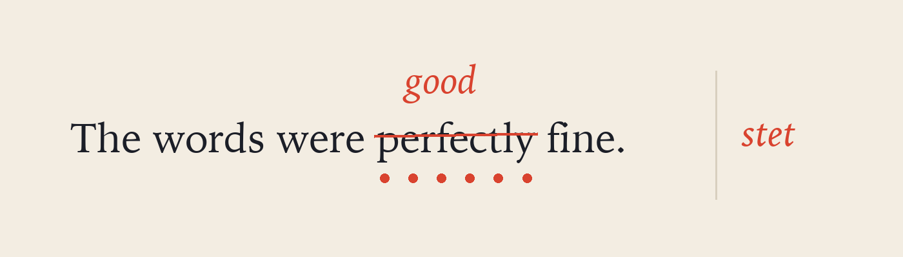

# Let it stand

Every editor I have used wanted to *help*. It finished my brackets, guessed my words and asked whether I meant something else. Stet does less. It shows the **source**, styled just enough to read, and stays out of the way.

The proofreader's oldest mark is a row of dots under a word: *stet*, let it stand. It is how you {~~ignore~>refuse~~}{>>id:s_7f3a91c2 by:Claude<<} a correction politely, and it is {++most of ++}{>>id:s_7f3a91c3 by:Claude<<}what reviewing a draft {--really, honestly --}{>>id:s_7f3a91c4 by:Claude<<}comes down to.

## What a draft needs

1. A quiet page that opens before you finish thinking of it.
2. Keys that never leave the keyboard — `ciw`, `dap`, `gt`.
3. Somewhere to put the research that is not the essay. See [[Reading list]].
4. A collaborator who suggests and never grabs the pen.



| Draft | Words | Suggestions | Kept |
|:------|------:|------------:|-----:|
| First | 1,083 | 41 | 12 |
| Second | 2,410 | 18 | 15 |
| Final | 2,262 | 3 | 3 |

> Write drunk on coffee; edit sober on tea.
> — a note in the margin

## The rest is typing

```rust
/// A keystroke reaches the screen in well under a millisecond.
fn on_key(editor: &mut Editor, key: KeyEvent) -> Frame {
    editor.handle(key);
    editor.frame()
}
```
